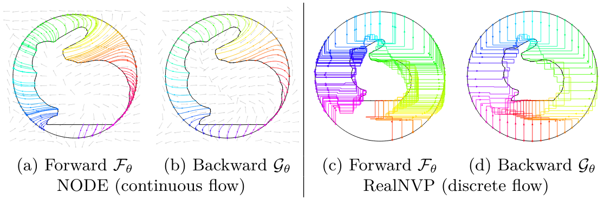

#+TITLE: Learning Diffeomorphic Flows from Shapes to the Sphere
#+AUTHOR: Paolo Zuzolo, Jan Ricardo Mussmann, *Guilherme Schardong*, Tiago Novello, Michael Moeller
#+VENUE: ECCV Workshop on Geometric Intelligence: From Vision to Scientific Discovery, 2026
#+SETUPFILE: ../setup.org
#+html_head: <link rel="stylesheet" href="../css/tufte.css" type="text/css" />
#+EXPORT_DATE: 2026-09-06

#+begin_teaser

#+end_teaser

* Abstract
We study the direct, unsupervised learning of a spherical parametrization of a single closed genus-0 shape $M \subset \mathbb{R}^d$, given as a polyline or triangle mesh. Instead of fitting a map $\mathbb{S}^{d-1} \rightarrow M$, we learn an ambient diffeomorphism $\Phi_\theta \in \operatorname{Diff}(\mathbb{R}^d)$ with $\Phi_\theta (M) = \mathbb{S}^{d-1}$, realized as a normalizing flow, either discrete (RealNVP coupling layers) or continuous (Neural ODE). A single network then provides both the spherical embedding $\mathcal{F}_\theta = \Phi_\theta |_{M}$ and the parametrization $\mathcal{G}_\theta = \Phi_\theta^{-1}|_{\mathcal{S}^{d-1}}$, exactly inverse to one another. The support objective alone is ill-posed: it admits maps whose Jacobian degenerates at high-curvature regions, which are then undersampled. We therefore regularize each flow through the quantities it exposes: a geodesically weighted repulsion on the images for the discrete flow; for the continuous one, a normal-alignment term, a Sobolev penalty on the velocity field $V_\theta$, and a barrier that transports the log volume element $\ell$ as an augmented ODE state, anchored at the distortion compatible with a bijection, $c=\log(\operatorname{vol}(\mathbb{S}^{d-1})/\operatorname{vol}(M))$. In 2D this yields near-isometric parametrizations; we discuss the open challenges in 3D.

* BibTeX
#+begin_src bibtex
@inproceedings{zuzolo:learning-diff-flows:2026,
  title={Learning Diffeomorphic Flows from Shapes to the Sphere},
  author={Paolo Zuzolo and Jan Ricardo Mussmann and Guilherme Schardong and Tiago Novello and Michael Moeller},
  booktitle={ECCV Workshop on Geometric Intelligence: From Vision to Scientific Discovery},
  year={2026},
  url={https://openreview.net/forum?id=RJLfhQ3wQh}
}
#+end_src
